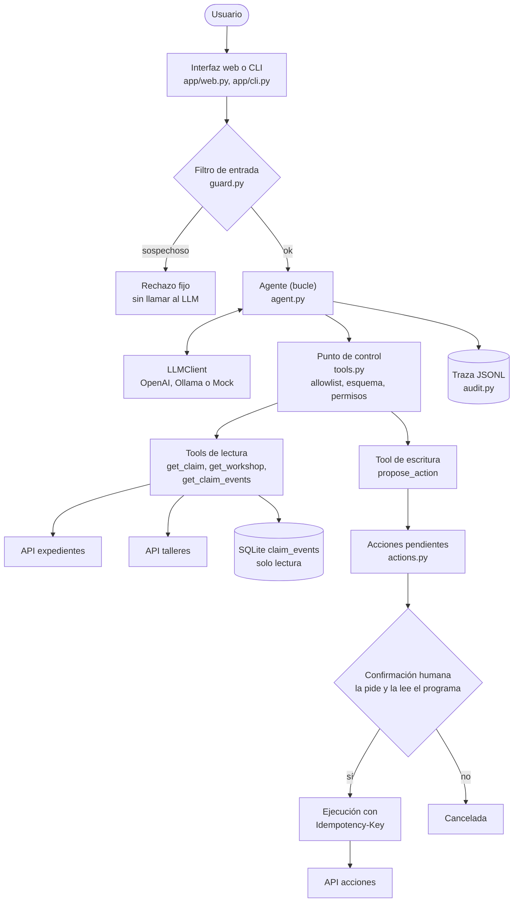
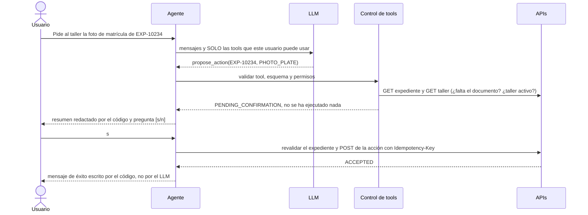
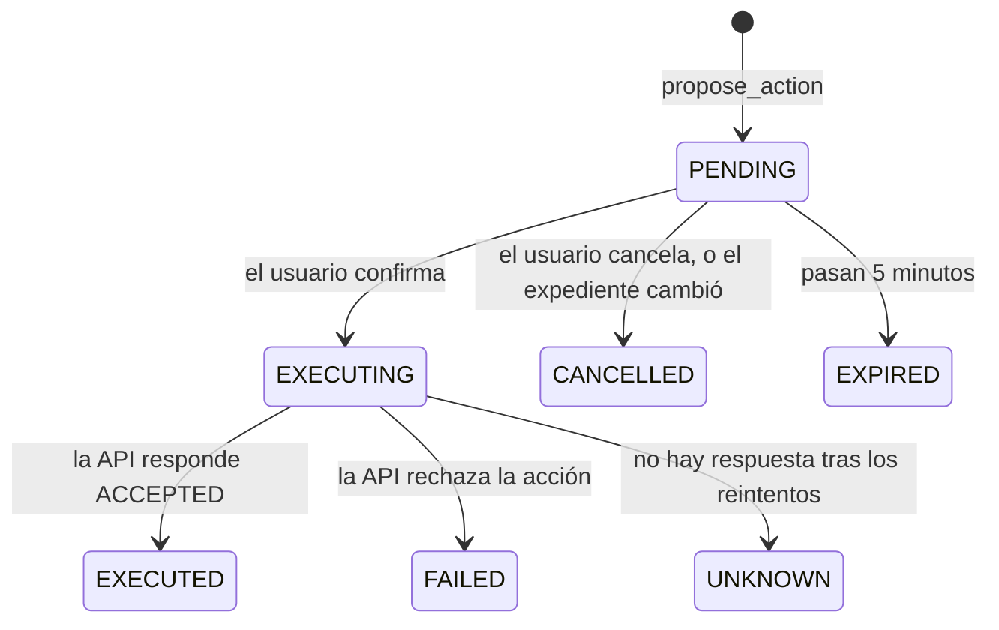

# Arquitectura

Un solo agente, un solo proceso, y una idea: **el LLM propone, el código dispone**. El modelo interpreta la petición y
elige herramientas de una lista cerrada; todo lo que no debe fallar nunca (permisos, validación, confirmación,
ejecución, reintentos, avisos) es código determinista.

## Componentes

Las APIs de expedientes, talleres y acciones, y la base SQLite, son el servicio simulado (`app/mock_services/`), con
fallos inyectables para probar el caso 3.

## Flujo de una acción con confirmación (caso 2)

## Capas de defensa

Ninguna depende de que el modelo se porte bien; cada capa asume que las anteriores han fallado.

| # | Capa | Dónde | ¿Depende del LLM? |
|---|---|---|---|
| 1 | Filtro de entrada (inyección, datos masivos, datos personales, longitud) | `app/guard.py` | No, pero es esquivable |
| 2 | Prompt de sistema con reglas y rol del usuario | `app/agent.py` | Sí: solo guía |
| 3 | Tools mínimas: sin listados, sin datos personales, sin SQL libre | `app/tools.py` | No |
| 4 | Allowlist, esquemas estrictos, permisos por usuario y rol | `execute_tool_call` | No |
| 5 | Confirmación humana, un solo uso, caducidad, revalidación | `app/actions.py` | No |
| 6 | Idempotencia en la API de acciones | `ServiceClient`, `mock_services` | No |
| 7 | Avisos de fallo y comprobación de identificadores en la salida | `agent.py`, `grounding.py` | No |

## Estados de una acción pendiente

`UNKNOWN` significa que no se sabe si la acción se hizo. No se informa de éxito ni se repite a ciegas; en producción
lo cerraría un proceso de reconciliación (ver README).
